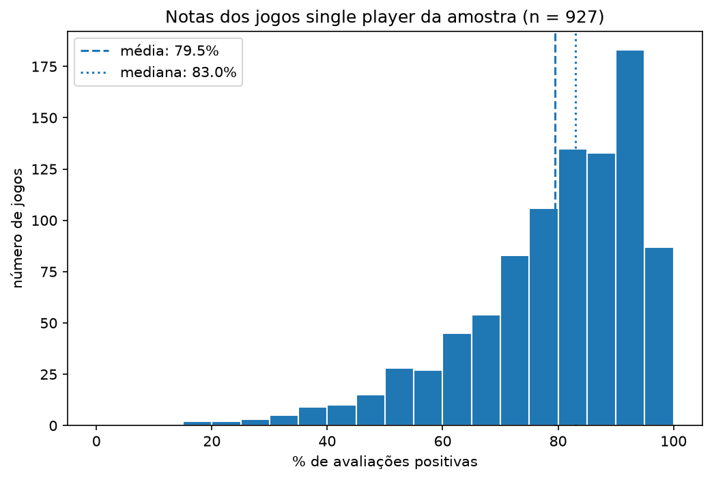
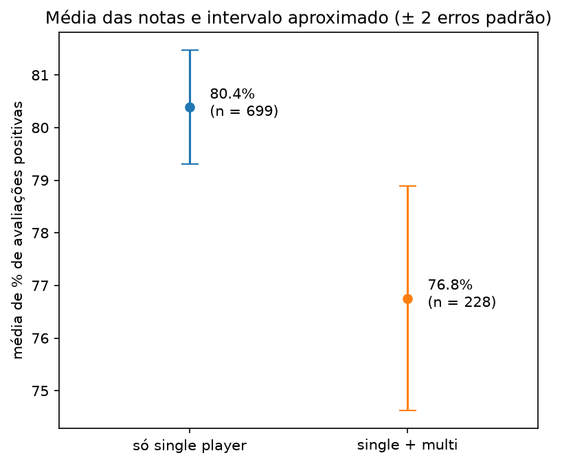

# Jogos single player na Steam: o que explica uma boa avaliação?

> 🚧 Projeto em andamento: a coleta, o banco e a primeira análise estão prontos. Os próximos passos são os gêneros e um dashboard em Power BI.

## A pergunta
Quis entender o que diferencia os jogos single player bem avaliados na Steam. Coletei os dados por API, guardei num PostgreSQL e analisei em SQL e Python.

## O que encontrei até agora
- Numa amostra sorteada de 927 jogos, a nota média (% de avaliações positivas) é 79,5% e a mediana é 83,0%. A distribuição tem uma cauda longa para as notas baixas.
- Os jogos sem modo multijogador têm nota maior que os que também têm: 80,4% contra 76,8% em média. Mantendo popularidade, preço e época de lançamento fixos, a diferença estimada é de 4,6 pontos (intervalo de 95%: 2,3 a 7,0).
- Isso descreve a amostra. Não mostra que o multijogador causa a diferença.

## Limitações
- **Amostra pequena:** os detalhes da loja (data de lançamento e categorias) foram pedidos só para 1.000 jogos sorteados, e 927 entram na análise, cerca de 4% dos 23.049 que têm 100 ou mais avaliações. Pedir todos levaria mais de 10 horas.
- **Corte de 100 avaliações:** deixa de fora jogos pouco conhecidos. Repeti a regressão com corte de 200 (675 jogos) e a diferença com controles ficou em 4,7 pontos. O corte de 50 não foi testado.
- **"Só single player"** quer dizer sem a categoria `Multi-player`, então jogos só com `Co-op` entram nesse grupo.
- **Dados do SteamSpy:** o número de donos é uma estimativa em faixas, e 4.042 jogos apareceram repetidos entre páginas (cópias idênticas). Não dá para medir jogos que não apareceram em nenhuma página.
- **Fim da coleta não confirmado:** baixei as páginas 0 a 86 do SteamSpy. A 86 veio com 544 jogos, o que sugere o fim da lista, mas as páginas 87 e 88 responderam com um erro de conexão do servidor e eu não confirmei que não existem páginas depois. Se existirem, os jogos delas (provavelmente os com menos donos, já que o `all` vem ordenado por donos) não estão na análise.
- **Comparação observacional:** o modelo é linear numa nota limitada entre 0 e 100, e as categorias de popularidade, preço e época foram agrupadas por escolha minha. Os intervalos são aproximados.
- **Dados de um dia só** (5 de novembro de 2026), e o preço é o preço atual.

As decisões completas, com os porquês, estão no [DECISIONS.md](DECISIONS.md).